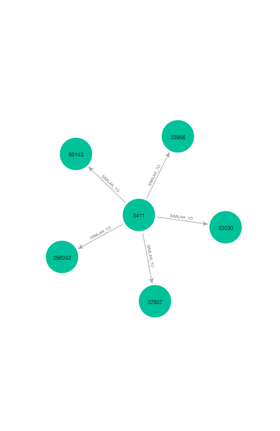

# UTS Graf Sains Data: Sistem Rekomendasi Item-Based dengan Neo4j (RetailRocket)

Repositori ini berisi pengerjaan **Ujian Tengah Semester Graf Sains Data** (Prodi S1 Sains Data, FMIPA, Universitas Negeri Surabaya, Gasal 2026/2027) dengan materi *Python Driver untuk Neo4j dan Rekomendasi*.

| | |
|---|---|
| **Nama** | Ananda Sakinah |
| **NIM** | 23031554060 |
| **Kelas** | 2023-E |
| **Mata kuliah** | Graf Sains Data (3 SKS), sifat ujian individu |

## Ringkasan

Dataset interaksi e-commerce **RetailRocket** (Roman Zykov, Kaggle) dimodelkan sebagai graf berarah antara pengunjung (`Visitor`) dan produk (`Item`) di **Neo4j**. Dari graf tersebut dibangun:

1. representasi **Vector Space Model (VSM)** untuk simpul User dan Item,
2. **proyeksi Item-Item** dengan *cosine similarity*, yang ditulis kembali ke graf sebagai relasi `SIMILAR_TO`,
3. **rekomendasi item berbasis KNN (k = 5)** untuk seorang user acak, dievaluasi dengan **Hit@5** dan **NDCG@5** pada data periode uji.

## Isi Repositori

```
.
├── Code UTS_Ananda Sakinah_23031554060_2023-E.ipynb   # notebook utama (seluruh pengerjaan + penjelasan)
├── requirements.txt                                   # dependensi dari soal (lihat catatan versi di bawah)
├── data/
│   ├── similarity_item_top5.csv                       # hasil similarity: top-5 tetangga per item
│   ├── events_p1.csv                                  # data training (P1), tidak disertakan di repo (besar)
│   ├── events_p2.csv                                  # data testing (P2), tidak disertakan di repo (besar)
│   └── events.csv                                     # data mentah RetailRocket, unduh dari Kaggle
├── visualisation 1.2.png                              # hasil tutorial driver Neo4j (graf Arthur)
├── 7.b.png                                            # graf item acuan dan 5 item paling mirip
├── Graff sebelum similarity.png                       # graf sebelum perhitungan similarity
└── Graff sesudah similarity.png                       # graf sesudah perhitungan similarity
```

## Dataset

- **Sumber:** [RetailRocket recommender system dataset](https://www.kaggle.com/datasets/retailrocket/ecommerce-dataset) (Kaggle). Hanya berkas `events.csv` yang dipakai.
- **Ukuran:** 2.756.101 baris, 5 kolom.

| Kolom | Keterangan |
|---|---|
| `timestamp` | Waktu dalam format Unix epoch (milidetik) |
| `visitorid` | ID unik pengunjung |
| `event` | Jenis interaksi: `view`, `addtocart`, `transaction` |
| `itemid` | ID unik produk |
| `transactionid` | ID transaksi, hanya terisi saat `event = transaction` |

Unduh dan letakkan `events.csv` di folder `data/`:

```bash
# Linux / macOS
curl -L -o ecommerce-dataset.zip https://www.kaggle.com/api/v1/datasets/download/retailrocket/ecommerce-dataset
```

```powershell
# Windows PowerShell
curl.exe -L -o ecommerce-dataset.zip https://www.kaggle.com/api/v1/datasets/download/retailrocket/ecommerce-dataset
```

Jika unduhan otomatis ditolak Kaggle, unduh manual dari halaman dataset di atas.

### Pembagian periode (filter pada `timestamp`)

| Fold | Periode | Jumlah baris | `view` | `addtocart` | `transaction` |
|---|---|---|---|---|---|
| **P1** (training) | 08/05/2015 s.d. 27/07/2015 | 1.710.737 | 1.655.412 | 41.699 | 13.626 |
| **P2** (testing) | 28/07/2015 s.d. 17/08/2015 | 385.955 | 372.173 | 10.511 | 3.271 |

Konversi waktu memakai `pd.to_datetime(..., unit="ms")` (UTC). Hanya **P1** yang dimasukkan ke graf. **P2** hanya dipakai sebagai data uji (*ground truth*) saat evaluasi.

## Model Graf

```
(:Visitor {visitorId}) -[:VIEWED {timestamp}]----------------------> (:Item {itemId})
(:Visitor)             -[:ADDED_TO_CART {timestamp}]--------------> (:Item)
(:Visitor)             -[:BOUGHT {timestamp, transactionId}]------> (:Item)
(:Item)                -[:SIMILAR_TO {score, metric: 'cosine'}]---> (:Item)   # ditambahkan pada tahap similarity
```

Komposisi subgraf hasil impor P1 (database `utsp1`):

| Jenis simpul | Jumlah | | Jenis relasi | Jumlah |
|---|---|---|---|---|
| `Visitor` | 870.768 | | `VIEWED` | 1.655.412 |
| `Item` | 191.284 | | `ADDED_TO_CART` | 41.699 |
| | | | `BOUGHT` | 13.626 |

Setelah similarity ditulis, ditambahkan **134.072** relasi `SIMILAR_TO`.

## Metodologi

### 1. Impor data ke Neo4j
Impor dilakukan dengan Neo4j Python Driver secara **batch** (5.000 baris per transaksi) memakai `UNWIND` + `MERGE` untuk simpul dan `CREATE` untuk relasi, dengan *uniqueness constraint* pada `Visitor.visitorId` dan `Item.itemId`. Subgraf P1 ditulis ke database terpisah bernama `utsp1` agar tidak bercampur dengan data lain.

### 2. Vector Space Model (VSM)
Bobot interaksi: `VIEWED = 1`, `ADDED_TO_CART = 3`, `BOUGHT = 5` (dijumlahkan per pasangan visitor-item). Matriks disimpan dalam format sparse (`scipy.sparse.csr_matrix`).

| Karakteristik | VSM User (User × Item) | VSM Item (Item × User) |
|---|---|---|
| Shape | 870.768 × 191.284 | 191.284 × 870.768 |
| Elemen tidak nol (nnz) | 1.328.023 | 1.328.023 |
| Sparsity | 99,9992% | 99,9992% |
| Memori sparse | 19,4 MB | 16,7 MB |
| Memori jika dense | 1.332,5 GB | 1.332,5 GB |
| Rata-rata nonzero per vektor | 1,53 | 6,94 |
| Median | 1 | 2 |
| Vektor hanya punya 1 elemen | 79,7% | 38,5% |
| Maksimum | 2.362 | 1.670 |

Plot `networkx` (graf bipartit) memakai sampel kecil dengan seed tetap agar mudah dibaca.

### 3. Pemilihan proyeksi
**Proyeksi Item-Item dipilih** karena lebih efisien (simpul 870.768 menjadi 191.284, pasangan yang mungkin turun sekitar 20,7 kali) dan lebih efektif (vektor item lebih padat: median 2 vs 1 elemen tidak nol, serta lebih stabil terhadap user baru).

### 4. Similarity
- Metrik: **cosine similarity** pada VSM Item berbobot.
- Hanya pasangan item dengan **minimal 2 user bersama** yang dihitung, dan disimpan **top-5 tetangga per item**.
- Hasil: 134.072 pasangan untuk 38.657 item (20,2% dari seluruh item). Disimpan ke `data/similarity_item_top5.csv` dan ditulis ke graf sebagai relasi `SIMILAR_TO`.

Item acuan (item terpopuler, **5411**) dan 5 item paling mirip:

| Item mirip | Similarity |
|---|---|
| 33030 | 0,145366 |
| 33956 | 0,100019 |
| 37807 | 0,098314 |
| 256242 | 0,092615 |
| 89143 | 0,079983 |

Contoh query Cypher:

```cypher
MATCH (a:Item {itemId: 5411})-[s:SIMILAR_TO]->(b:Item)
RETURN a.itemId AS item_acuan, b.itemId AS item_mirip, s.score AS similarity
ORDER BY s.score DESC
LIMIT 5
```

### 5. Rekomendasi KNN dan evaluasi (2.2 Analytics)
**Pemilihan user (reproducible).** Kandidat user harus: (a) muncul di P1 dan P2, (b) menyentuh minimal 2 item di P1, dan (c) punya minimal 1 item **baru** di P2. Dari 6.500 kandidat dipilih satu user dengan `numpy.random.default_rng(42)`, yaitu **user 124912**.

**Rekomendasi.** Untuk tiap item yang pernah disentuh user, diambil tetangga `SIMILAR_TO` (k = 5). Skor kandidat adalah jumlah `bobot_interaksi × similarity`, dengan item yang sudah pernah disentuh user dikeluarkan.

**Hasil user 124912:**

| Peringkat | Item | Skor |
|---|---|---|
| 1 | 387318 | 1,2822 |
| 2 | 181050 | 1,0296 |
| 3 | 179136 | 0,9077 |
| 4 | 130828 | 0,7787 |
| 5 | 359040 | 0,7198 |

Tiga item teratas (387318, 181050, 179136) menjadi item yang diiklankan. Item relevan pada P2 adalah **158962**.

| Metrik | Nilai |
|---|---|
| Hit@5 | 0 |
| NDCG@5 | 0,0000 |

**Penjelasan.** Item 158962 ada di graf P1 dan hanya disentuh 2 user, tetapi tidak punya pasangan item dengan minimal 2 user bersama, sehingga tidak memiliki relasi `SIMILAR_TO` sama sekali. Karena KNN menelusuri relasi `SIMILAR_TO` dari item riwayat user, item ini tidak dapat dijangkau. Secara agregat hanya 20,2% item yang punya relasi `SIMILAR_TO`, sehingga hasil ini mencerminkan keterbatasan metode pada item *long-tail* dengan data sangat sparse, bukan kesalahan implementasi.

> **Catatan keterbatasan.** Evaluasi pada repositori ini dilakukan pada **satu user** (sesuai soal), sehingga Hit@5 hanya bernilai 0 atau 1 dan belum mewakili performa model secara keseluruhan.

## Hasil Visualisasi

| Tutorial driver (1.2) | Item acuan dan 5 tetangga |
|---|---|
|  |  |

| Sebelum similarity | Sesudah similarity |
|---|---|
|  |  |

## Cara Menjalankan

### Prasyarat
- Python 3.10 atau lebih baru
- [Neo4j Desktop](https://neo4j.com/download/) (atau instance Neo4j lain) yang berjalan di `bolt://localhost:7687`, dengan password akun `neo4j` **sudah diganti** dari password bawaan. Neo4j menolak query selama kredensial bawaan belum diubah.
- Dukungan multi-database (untuk membuat database `utsp1`), tersedia di Neo4j Desktop.

### Instalasi

```bash
python -m venv myvenv
# Windows
myvenv\Scripts\activate
# Linux / macOS
source myvenv/bin/activate

pip install "neo4j>=5.5" pandas numpy scipy scikit-learn networkx matplotlib tqdm ipykernel
```

> **Catatan versi driver.** `requirements.txt` bawaan soal memasang `neo4j==4.2.1`, padahal `driver.execute_query()` dan `RoutingControl` yang dipakai di tutorial baru tersedia mulai **neo4j 5.5**. Pengerjaan ini memakai **neo4j 6.4.1**. Jika tetap memakai `requirements.txt` bawaan, upgrade driver terlebih dahulu.

### Konfigurasi kredensial
Ubah bagian koneksi di notebook sesuai instance milikmu (URI dan password). **Jangan menyimpan password asli ke repositori publik.** Lebih aman memakai variabel lingkungan:

```python
import os
URI  = os.getenv("NEO4J_URI", "neo4j://127.0.0.1:7687")
AUTH = (os.getenv("NEO4J_USER", "neo4j"), os.getenv("NEO4J_PASSWORD"))
```

### Urutan menjalankan notebook
1. Letakkan `events.csv` di folder `data/`.
2. Buka notebook dan jalankan cell berurutan dari atas ke bawah.
3. Cell filter periode akan membuat `data/events_p1.csv` dan `data/events_p2.csv`.
4. Cell impor memakai `CREATE` untuk relasi, jadi **jangan menjalankannya dua kali pada database yang sama** (relasi akan ganda). Gunakan database baru atau kosongkan dulu.
5. Impor P1 (±1,7 juta baris) membutuhkan waktu beberapa menit hingga lebih lama, tergantung perangkat.

> Jika penghapusan seluruh data dengan `MATCH (n) DETACH DELETE n` gagal karena batas memori transaksi Neo4j, hapus secara bertahap (dengan `LIMIT`) atau buat database baru.

## Teknologi

Python · Neo4j (Cypher) · neo4j Python Driver 6.4.1 · pandas · NumPy · SciPy · scikit-learn · NetworkX · Matplotlib · tqdm · Jupyter

## Referensi

- Zykov, R. *RetailRocket recommender system dataset*. Kaggle.
- Neo4j Python Driver Manual: <https://neo4j.com/docs/python-manual/current/>
- Naskah soal UTS Graf Sains Data, Prodi S1 Sains Data, FMIPA Unesa, Gasal 2026/2027.
